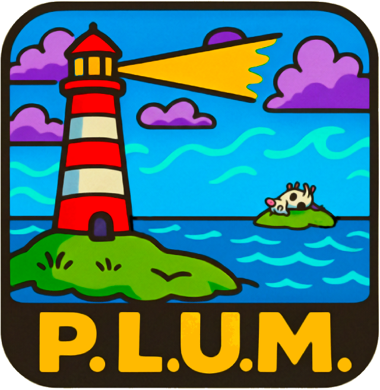
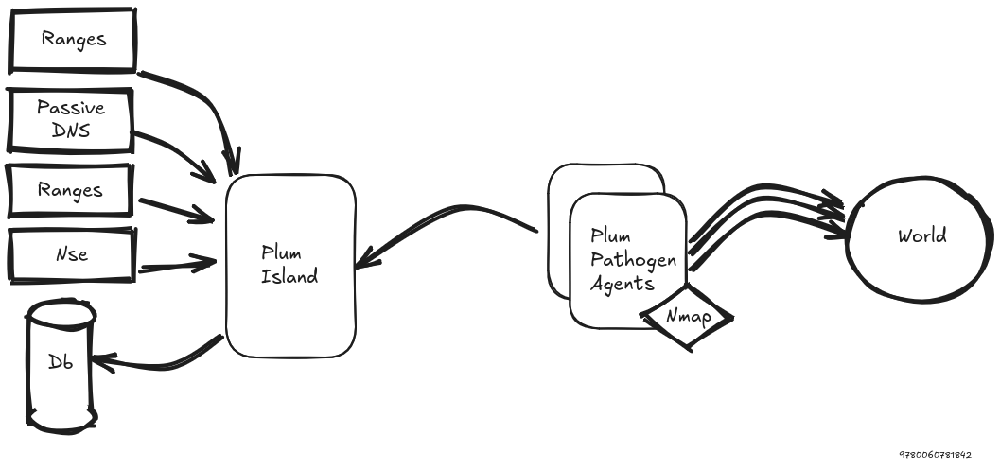

<div align="center">
  

<h1>Proactive Land Uncovering & Monitoring</h1>
  
</div>

<p align="center"><strong>Plum Island - 20 Years Hack.lu Release - v0.2610.0</strong><br /><em>Release in preparation — not yet published</em></p>

## Description

Plum Island is an orchestrator for proactive surface-exposure discovery.
It assigns scan jobs to distributed agents, collects their results, stores scan history, and makes the collected data searchable through indexed technical indicators.

The project is designed for repeated monitoring rather than one-shot scans: targets can be linked to scan profiles, jobs are queued by priority, results are kept over time, and reports can summarize what changed during a period.


## Main features

- Distributed scan orchestration with agents and server-side job queues.
- Target and scan profile management.
- Per-profile scan tracking for each target.
- Indexed search over IPs, networks, ports, DNS names, HTTP metadata, favicons, TLS certificates, banners, and computed tags.
- Structured query syntax with exact, prefix, substring, `AND`, `OR`, and date-range filtering.
- Active unfinished scan jobs are requeued by the scheduler after two hours;
  late agent results are rejected when ownership has changed.
- Tag rules that automatically add tags to matching scan documents.
- Favicon-based tagging using MD5, SHA-256, and mmhash indicators.
- Scheduled Markdown reports from the same search syntax used by the UI.
- CSV/JSON export workflows for search results.

## Search options

The search index supports fields such as:

- `ip`, `net`, `port`
- `fqdn`, `fqdn_requested`, `domain`, `domain_requested`, `host`, `tld`
- `http_title`, `http_cookiename`, `http_etag`, `http_server`
- `http_header`, `http_headval`
- `http_favicon_path`, `http_favicon_mmhash`, `http_favicon_md5`, `http_favicon_sha256`
- `banner`
- `x509_issuer`, `x509_issuer_cn`, `x509_subject`, `x509_subject_cn`, `x509_san`, `x509_md5`, `x509_sha1`, `x509_sha256`

`fqdn`, `host`, and `domain` include normalized hostnames found in TLS certificate DNS SAN and subject CN data. Rebuild or reimport the Kvrocks index to apply parser improvements to existing scans.
- `tag`

Certificate searches distinguish common names (`x509_issuer_cn`,
`x509_subject_cn`) from available serialized DN attributes (`x509_issuer`,
`x509_subject`). Existing installations must coordinate saved-query conversion
and index rebuilding; see the [certificate upgrade guide](migration_full_cert.md).

Example:

```text
domain.begin:"circl.lu" port:443 http_server.lk:nginx
```

Exclude matching scans with `NOT`, for example
`tag:type:router AND NOT tag:vendor:mikrotik`. Operators are case-insensitive;
each OR group requires a positive term, and exclusion applies per scan UID.


See [Search documentation](documentation/search.md) for the full field list, modifiers, examples, and date-range behavior.

Append `debug` (for example `http_server.lk:apache debug`) to inspect and download
per-page performance diagnostics without changing search criteria.

## Tagging

Tag rules are stored as YAML definitions and can also be managed from the web UI.
Each rule contains a mandatory canonical `uuid` and `name`, a description, a
search query, a list of tags, and a version timestamp. UUID is the unique rule
identity; display names may repeat and come from YAML, not the filename. Use a
new UUID for a new rule and retain it when updating that rule.

Example:

```yaml
uuid: 5673172d-c76e-4d25-b1fd-4ab3851c6167
name: hashicorp-vault-example
description: HashiCorp Vault
query: http_favicon_mmhash:747250914 AND http_title.bg:Vault
tags:
- product:hashicorp-vault
- vendor:hashicorp
version: 20260428T170756Z
```

See the [Plum-Antibodies tag documentation](https://github.com/D4-project/Plum-Antibodies/blob/main/documentation/tagging.md)
for YAML format and version handling. Import and reindex commands remain in
the [Plum Island tools documentation](documentation/tools.md).

## Reports

Reports use the same structured search syntax as the interactive search page.
They generate reports for a reporting interval and can be previewed, downloaded as PDF, run manually, or sent on a schedule. Email contains a short summary with the complete PDF attached.

See [Reports documentation](documentation/reports.md) for setup, query semantics, UTC schedules, report content, SMTP sender and TLS configuration, PDF attachments, and troubleshooting.

## Documentation

- [v0.2610.0 release notes (in preparation)](release_note.md)
- [Installation](documentation/installation.md)
- [Migration](documentation/migration.md)
- [Upgrade from v0.2606.0](documentation/migration-v0.2606.0-to-main.md)
- [Certificate CN/DN upgrade](migration_full_cert.md)
- [Search](documentation/search.md)
- [Tagging rules](https://github.com/D4-project/Plum-Antibodies/tree/main/tags)
- [Tag tooling](documentation/tools.md#tag-tools)
- [Reports](documentation/reports.md)
- [Scan profiles, scheduling, and priority](documentation/scanning.md)
- [Tools](documentation/tools.md)
- [Search index recovery](documentation/recovery-tools.md)
- [Kvrocks objects](documentation/kvrocks_objects.md)

## Technical requirements

- Python 3.10+
- Flask AppBuilder 4.8
- Meilisearch 1.22.2+
- Kvrocks unstable build 8f04af34+, with RocksDB 10.4.2+

Python package dependencies are listed in [requirements.txt](requirements.txt):

- `flask-appbuilder==4.8.1`
- `flask-Limiter==3.12`
- `APScheduler>=3.11.0`
- `netaddr>=1.3.0`
- `meilisearch>=0.37.0`
- `redis>=6.4.0`
- `PyYAML>=6.0.3`
- `pyfaup-rs>=0.4.9`
- `pybgpranking2>=2.0.2`
- `pyipasnhistory>=0.1`
- `nmap2json`

## Quick setup

```bash
git clone --recurse-submodules https://github.com/D4-project/Plum-Island
cd Plum-Island
./setup.sh
```

The setup script creates a local Python virtual environment, installs `requirements.txt`, creates the Flask AppBuilder admin user, and loads initial data:

- default TCP ports
- HTTP header tagging collection
- YAML tag rules from `webapp/tags/tags/`
- NSE scripts from `https://github.com/D4-project/Plum-Rules-NSE`
- all-target `Default banner scan` profile for TCP ports 22, 80, and 443 with the [default NSE scripts](documentation/tools.md#initial_setuppy)

To refresh an existing clone, run `./updisland.sh` from the Plum-Island root.
It updates Plum-Island and the Plum-Antibodies tag-rules submodule.

See [Installation documentation](documentation/installation.md) for Meilisearch, Kvrocks, Passive DNS, Docker, and runtime configuration details.
