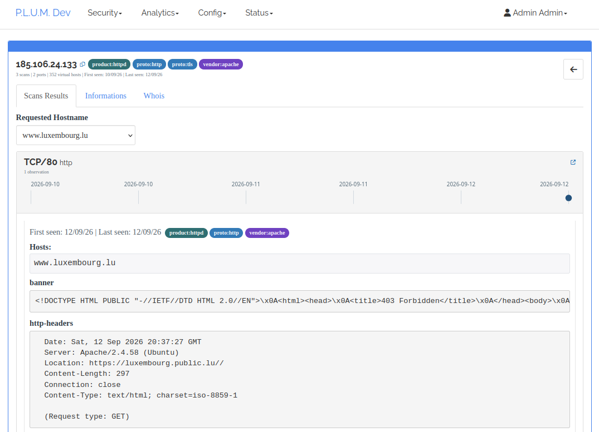
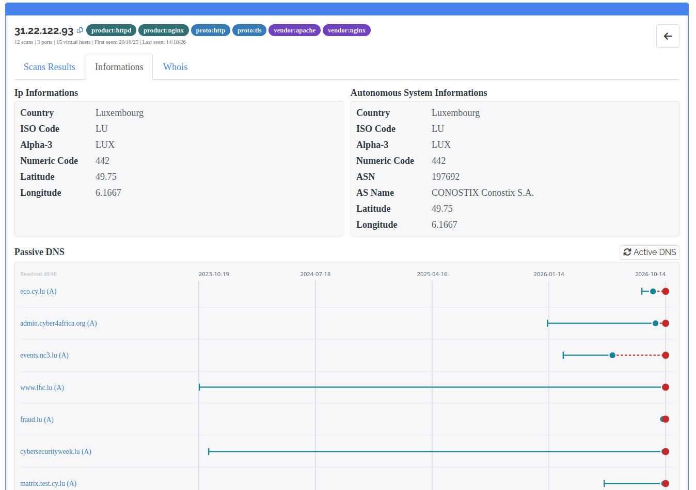
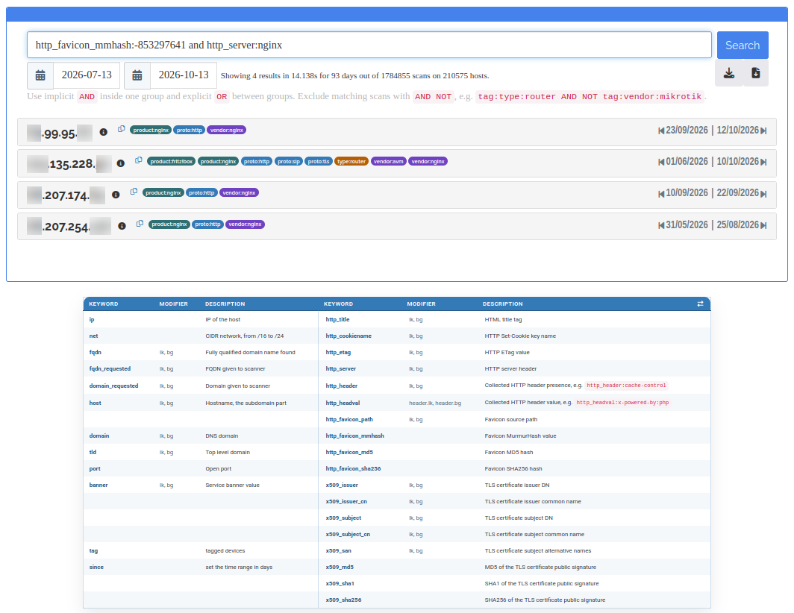

# Unreleased

- Search supports single-level parentheses with shared report/tag-rule validation
  (#254). Candidate planning reuses per-value Kvrocks counters, factors shared
  filters and exposes anonymous estimates/order in `debug`; no migration required.
  Performance remains experimental pending representative deployment benchmarks.

# Plum Island - 20 Years Hack.lu Release - v0.2610.0

Released on **2026-10-14**. Git tag: **v0.2610.0**.
The changes below describe what v0.2610.0 brings compared with v0.2606.0.

## Highlights

- Expanded technology detection and UUID-based tag rules, with shared validation,
  rule-driven HTTP header collection and GUI reindex controls.
- Redesigned IP exploration: interactive port and Passive DNS timelines,
  on-demand hostname reports and asynchronous enrichment.
- Complete PDF reports with clickable navigation, attached to concise report emails.
- Clickable search keywords and tag catalogues, standalone `NOT` exclusions,
  richer certificate search and a protected InfoIP API.
- Target insertion dates, network/AS enrichment, WHOIS and routing-aware scheduling.
- Date-insensitive scan deduplication and history-preserving migration tooling.

## Tags and technology detection

- Tag rules now use a mandatory unique UUID. Names come from YAML and may repeat;
  imports and updates identify rules by UUID rather than filename or display name.
- Tag syntax validation is shared with Plum-Antibodies across the UI and import
  paths. Repository updates refresh the Antibodies rules.
- The tag-rules UI provides reindex actions for all rules or one selected rule,
  with live progress and a shared CLI/GUI lock. IP search results load deduplicated
  tag badges asynchronously.
- Active YAML rules determine which HTTP headers must be collected. Kubernetes
  headers no longer belong to the global default collection. Its certificate SAN
  detection covers `kubernetes.default`, `kubernetes.default.svc` and
  `kubernetes.default.svc.cluster.local`, without implying HTTP.
- TLS observations receive `proto:tls`; generic webmail uses `type:webmail`.
- Expanded web/application detection: Nginx (#208), OpenResty (#185), Lighttpd
  (#201), SimpleHTTP, TeamCity (#194), ScreenConnect (#193), Gitea (#184),
  Wyse Management Suite (#183), Plesk (#187), SAP (#198), Pterodactyl (#202),
  Apache JMeter (#205), and separate Apache/Debian banner signals (#203).
- Expanded network/security detection: FRITZ!Box (#206), Cisco Switch (#159),
  SonicWall Secure Mobile Access (#191), NordVPN (#197), BVPN (#199), OPNsense
  (#200), Sucuri (#121) and Ivanti (#181).
- Expanded camera, telephony and parking fingerprints: Dahua (#204), INSTAR
  (#211), MixVoip (#224), Gandi (#222) and OVH (#223).
- Mail detection covers SMTP/ESMTP (#212), Postfix/Ubuntu (#213), Exim (#215),
  Dovecot POP3 (#216) and IMAP capability greetings (#217).
- The bundled Antibodies revision includes additional MISP, Laravel, Polylang,
  WordPress, Drupal, Passbolt, Home Assistant, FRITZ!Repeater, Reolink,
  Danfoss StoreView, One Identity Safeguard and Ivanti Connect Secure signals.
  Proxy and hosting header detection covers Google, Fly.io, Varnish and Caddy,
  with refined Nginx default-installation, SonicWall SMA and OpenVPN rules.

## Visual exploration and IP details

- Interactive SVG timelines replace the per-port date tabs. Each port shows
  first/last-seen ranges and clickable end points; the newest report is selected
  initially. All ports share the visible hostname group's time scale.
- Passive DNS uses one timeline panel with `Rdata (RRType)` rows, a shared date
  axis and first/last-seen markers.
- An **Active DNS** button beside the Passive DNS heading verifies A hostnames
  asynchronously. Matching IPs gain a red verification point connected to the historical
  last seen, without changing stored observation dates (#252).
- Requested-hostname reports load on demand and remain cached in page memory.
  Direct hostname links, browser back/forward and cached report selections are
  supported; obsolete responses never replace the active selection (#231).
- IP summary counts, tags and dates describe the selected hostname group.
  Web links follow the active observation, require `proto:http`, retain the
  scanned port and use HTTPS only with port-local TLS evidence.
- The Informations tab loads IP metadata and Passive DNS independently when opened,
  with centered loading indicators. IP and AS information appear in equal-height,
  side-by-side cards on wide screens. WHOIS uses the same loading feedback.
- Target results load incrementally with timing and a load-more control (#182),
  shared tag badges and consistent IP/detail navigation (#220).
- Stats includes the number of unique ports configured across scan profiles.

## Reports and PDF delivery

- Report previews render safe HTML with an anchored index and print support (#218).
- PDFs include a cover, an index on page 2, section page breaks and clickable
  internal links to the full host dump.
- Manual and scheduled emails attach the complete PDF. The body contains only
  report metadata, open-port host counts, an attachment notice and the disclaimer.
  PDF generation must succeed before email delivery.
- Reports group newly opened ports by port, list detected FQDNs with associated
  IPs, and separate additional Passive DNS names with last-seen timestamps.
  Non-empty service sections cover web, mail and remote access (#219).
- Report queries are validated when saved, using the existing search parser and
  shared tag validator. Invalid queries produce field errors without changing
  the saved schedule or querying search backends (#230).

## Search and APIs

- Search keywords append directly to the query bar. A header toggle switches
  between syntax help and five clickable SQL-backed tag columns: protocols,
  types, products, vendors and vulnerabilities (#229).
- Case-insensitive standalone `NOT` excludes matching scan UIDs within each OR
  group. Interactive search, exports, matching history and tag rules support it.
- Certificate searches distinguish full issuer/subject DNs from explicit
  `x509_issuer_cn` and `x509_subject_cn` fields. Normalized certificate SAN/CN
  hostnames also populate FQDN, host and domain search fields (#186).
- Domain extraction uses offline `pyfaup` suffix data, including FQDN-to-domain
  extraction for WHOIS, instead of ad-hoc label splitting and online TLD loading.
- Search history expansion and tag loading run asynchronously; timestamp reads
  are scoped to matching UIDs.
- A protected Swagger InfoIP endpoint at `/api/v1/infoip/<ip>` returns per-port
  tags, TCP/UDP protocol, first-seen and last-seen timestamps for one public IPv4
  or IPv6 address. It defaults to 30 days and supports a two-year lookback cap.
  CIDRs are rejected; this does not add IPv6 scanning support.
- Authenticated REST CRUD APIs manage ports (#174) and NSE scripts (#172).

## Targets and scan orchestration

- Targets have insertion timestamps, explicit IP/CIDR or FQDN classification and
  shared AS/network metadata from CIRCL. Migration backfills insertion dates
  from available scan history, using migration time when none exists (#227, #189).
- CIDR network data uses a 24-hour cache; authorized manual refreshes bypass it.
  FQDNs do not receive CIDR AS metadata.
- Target and IP views offer WHOIS. FQDN lookups use the extracted registrable
  domain; network lookups follow inter-RIR transfers to retrieve the CIDR record.
- Before scheduling a CIDR, routing information is checked through the CIRCL cache.
  ASN `0` means `CIDR not announced`: the scan state completes without scanning
  or exporting a result. Failed refreshes of stale/unknown routing data defer work.
- Scan-profile cycles have bounded target membership and visible completion
  blockers (#196). Queue generation uses short, bounded commits and index-ordered
  due-state queries to reduce SQLite contention.
- Optional per-profile Nmap parameters are validated, snapshotted into jobs and
  sent to agents (#188). Queued snapshots synchronize after profile edits.
- Meilisearch export tasks persist across scheduler ticks; waiting for indexing
  no longer blocks job generation. Kvrocks export follows successful Meilisearch work.
- Queue/result counts, per-stage progress and an independent queue watchdog improve
  operational visibility. Unfinished agent jobs are requeued after two hours
  (#190); agents can explicitly release interrupted jobs (#180).

## Installation, tools and operations

- Fresh setup labels TCP ports with known local service names and seeds eight
  default NSE scripts: HTTP headers/title, certificate, SSH host key, ALPN,
  banner, Modbus and hash-based favicon collection. Missing defaults fall back
  to bundled scripts; `http-favicon.nse` is excluded.
- WHOIS range import downloads RIR data, filters country/word matches, reduces
  covered CIDRs and imports through the least-privilege Feeder API role.
  Existing wider CIDRs prevent redundant target creation.
- Passive DNS FQDN learning resolves configured domain/TLD matches before import.
  Import tools expose progress and rotating logs.
- Smarthash migration normalizes volatile dates, merges date-only duplicates and
  observation bounds, and retains the newest payload deterministically. It offers
  dry-run, disk-backed deduplication and explicit destination replacement.
- Full reimport validates history companions before replacing indexes. Missing or
  invalid history requires explicit acceptance of history loss (#140).
- Recovery tooling can resume raw-JSON reintegration for Kvrocks-only documents;
  protocol backfill supports older InfoIP data.
- Application logs optionally rotate daily with configurable retention (#192).
  Search performance diagnostics are documented in the
  [search guide](documentation/search.md#performance-diagnostics).
- Docker uses `plum-` service names and an external `plum_net` for agent
  connectivity (#165, #166), with persistent NSE uploads (#168).
- Installation, migration, SMTP, tool and contributor documentation is aligned
  with the implementation (#235–#248); getting-started guidance covers first use
  (#170). YAML technology-detection tests belong to Plum-Antibodies, while generic
  parser and tag-engine coverage remains here.
- A [network requirements guide](documentation/network.md) documents incoming
  and outgoing connections, backend ports and external dependencies, with an
  ASCII topology covering Island, scanners and browsers.

## Upgrade notes

Choose the [migration guide for your installed version](documentation/migration.md).
Do not apply the legacy IP-to-port split to an installation already using per-port
documents. Backups and stopping writers remain the operator's responsibility.

- Apply the SQL migrations required by the source version, including UUID rule
  identity, target network metadata and target classification.
- Convert saved certificate CN queries before importing updated rules and rebuilding
  indexes; see the [certificate migration](migration_full_cert.md). A tag-only
  reindex cannot populate the new certificate fields.
- Existing results need a Kvrocks rebuild with retagging to gain newly collected
  rule-dependent headers, including TeamCity's `TeamCity-Node-Id`. Restoring the
  previous rule and rebuilding tags provides the corresponding rollback.
- Update scanner `nmap2json` dependencies before resuming scans after smarthash
  migration.
- Synchronize configured roles with `tools/initial_setup.py --roles-only`.
  Bare-metal and Docker deployments also synchronize role definitions.

## Bug fixes and hardening

- **Scheduling and ingestion:** prevent already completed targets from being
  rescheduled within the same running cycle; show `finalizing` while remaining
  jobs drain. Write result files before marking jobs finished (#162), handle
  malformed submissions, and fix scheduler Kvrocks initialization (#148).
- **Network information and WHOIS:** accept ASN `0` and unknown-country
  responses as valid unannounced results instead of retrying indefinitely.
  Use unambiguous ARIN syntax, remove duplicated legal notices, follow transfers
  only to known RIRs and reject referral loops. Target pages open on Details,
  including after browser-history restoration.
- **Tags:** tolerate repeated tags during retagging, restore aggregate IP tag
  display, correct MySQL's query field, distinguish POP3 `+OK` from IMAP `* OK`
  greetings, and correct Sophos VPN fingerprint/title matching (#221).
  Repair tag flush/selector/interruption handling (#150) and refresh progress
  totals as new scan UIDs arrive.
- **Search and indexes:** clean up interrupted import indexes and reject partial
  replacement dumps. Revert the regressing #161 batching experiment; no production
  speedup is claimed from functional tests or diagnostic counters alone.
- **Access control:** remove Read Only user creation/edit permissions (#228) and
  Bulk Import access, while restoring permitted search, Stats, InfoIP and WHOIS
  helper access (#233). Bot status editing is limited to the active flag (#124).
- **Rendering and parsing:** escape dynamic target/search/detail content (#151)
  and skip non-external scan IPs to avoid private/localhost index pollution (#120).
- **Deployment:** align the tracked launcher port with Compose (#164), correct
  Docker dependency copy order, and enforce full-source-SHA migration filenames.

# Plum Island - Searing Spring Release - v0.2606.0

## v0.2606.0 Highlight
- HTTP header name and/or value acquisition engine.
- Switch from host to port in database - 86 Headers.
- Huge improvement of devices/software discovery - 844 Tags. 
- Docker availability and support thank's to t0kubetsu.  

## v0.2606.0 Changes 
- Other changes:
  - Make bot job submission idempotent (`ac9c7fe`)
  - Prevent concurrent scanner agents from claiming the same queued job
  - Return validation errors instead of TypeError for malformed bot UID fields, closes #86
  - Add scan profile cycle tracking with current and previous cycle visibility, closes #52
  - Add curated HTTP header presence/value collection and structured Kvrocks search, closes #54
  - Improve Kvrocks rebuild tooling: direct Meili rebuild, multiprocessing parser workers, retag mode, graceful Ctrl+C, quieter logs, and progress output (`23b9d83`)
  - Prevent network info refresh from crashing on FQDN targets, closes #116
  - Avoid blocking Kvrocks wildcard fallback searches on Redis KEYS, closes #90
  - Split tools Meilisearch config into `IN_MEILI_*` and `OUT_MEILI_*`; remove legacy `MEILI_*` tool config keys (`ef4ceec`)
  - Rework `index_meili.py` to import dumps into `OUT_MEILI_*`, with batching and optional `--progress` (`ef4ceec`)
  - Scheduler FQDN/IP job batching now fills 256-item packets when due targets remain, closes #51
  - Remove unused scheduler module-level job list, closes #102
  - Show scan profile cycle progress by concrete scan units instead of target rows, closes #118
  - Fix bot API SQLAlchemy limit calls to use integer arguments, closes #87
  - Bound Kvrocks rebuild memory use by preserving doc timestamps in place and parsing Meili pages batch-by-batch, closes #80
  - Make result parsing config explicit per call to avoid cross-thread parser state leaks, closes #88
  - Fix `setup.sh` to use explicit venv Python/Flask commands and seed HTTP header tagging plus a default banner scan profile during initial setup
  - Add required tool dependency update (`acbe2d1`)
  - Harden job result rendering against banner HTML injection, closes #37 (`7224443`)
- Tag-related changes:
  - Dropbear SSH (`eac052b`), FRITZ!Box SIP (`ff2fcc6`), Microsoft SMTP gateway (`b19b027`)
  - SIP protocol and SIP_Phone WWW-Authenticate realm tagging, closes #26 (`0227c6a`)
  - CrushFTP server header, closes #38 (`b41e40f`)
  - Red Hat Enterprise Linux HTTP server header in Apache RedHat detection, closes #39
  - NetScaler AAA title and LogonPoint path tagging, closes #40
  - Netskope Borderless SD-WAN certificate issuer tagging, closes #41
  - WatchGuard Fireware XTM favicon, title, and certificate tagging, closes #42
  - Cisco Catalyst SD-WAN title and certificate tagging, closes #43
  - ProFTPD, closes #36 (`3e4f7a2`)
  - Pure-FTPd, closes #35 (`d019905`)
  - pfSense, closes #34 (`6b609d9`)
  - Mitel 108, closes #30 (`0c019fa`)
  - Dovecot, closes #28 (`63e2001`)
  - Raspberry/Raspbian HTTP and SSH tagging, closes #25 (`2f618ba`, `b2c9b5e`)
  - Zyxel USG20 plus separate Zyxel SSH rule, closes #32 (`98e6e75`, `a2e0f95`)
  - Add `soft:ssh` to all SSH banner detections (`d8b16d2`)
  - Bump MixVoip tag rule version to force corrected `soft:telephony` import, closes #48
  - Normalize Apache favicon-derived tag names/tags and merge Tomcat favicon detection, refs #50
  - Normalize Cisco, Check Point, Debian, and Gargoyle tag rule names/tags, refs #50
  - Normalize Arris favicon-derived rule names/tags as router hardware, refs #50
  - Merge SonicWall favicon-derived rules into the main SonicWall rule, refs #50
  - Normalize Zyxel tag rule names/tags as Zyxel hardware, refs #50
  - Validate Ubuntu/Debian SSH banner tagging for OpenSSH package banners, refs #50
  - Merge Windows OpenSSH version-specific banner rules into one generic rule, refs #50
  - Add generic OpenSSH banner tagging and include `soft:openssh` on OpenSSH-derived rules, refs #50
  - Add generic SSH protocol banner tagging for `ssh-2.0` banners, refs #50
  - Add SSH banner rules for Cerberus FTP Server and MOVEit Transfer SFTP, refs #50
  - Add SSH banner rules for Serv-U FTP Server and WS_FTP SSH, keeping Serv-U web favicon separate, refs #50
  - Add NetScreen SSH banner tagging, refs #50
  - Add Cisco and Lancom SSH banner tagging, and classify Zyxel SSH as router hardware, refs #50
  - Add SFTPGo and Bitvise SSH Server banner tagging, refs #50
  - Add Crestron SSH banner tagging, refs #50
  - Add generic FTP welcome banner tagging for FTP server/service banners, refs #50
  - Add Microsoft FTP Service banner tagging, refs #50
  - Add FileZilla FTP Server banner tagging, refs #50
  - Add vsftpd FTP banner tagging, refs #50
  - Rename Mikrotik tag rule file typo from `microtik` to `mikrotik`, refs #50
  - Add Mikrotik FTP banner tagging, refs #50
  - Add QNAP NASFTPD/ProFTPD FTP banner tagging, refs #50
  - Add Debian ProFTPD FTP banner tagging, refs #50
  - Add Drupal x-generator header value tagging, closes #56
  - Add WordPress redirect and powered-by header value tagging with PHP classification, closes #57
  - Add PHP and Ubuntu x-powered-by header value tagging, closes #62
  - Merge Joomla favicon rules and add x-content-encoded-by header value tagging, closes #59
  - Merge OWA favicon rules and add x-owa-version header tagging, closes #60
  - Add Polylang x-redirect-by header value tagging, closes #61
  - Replace SSH software tag with proto:ssh and tighten generic SSH banner tagging, closes #65
  - Add generic HTTP banner/header protocol tagging, closes #64
  - Add Telnet protocol negotiation banner tagging, closes #72
  - Add Telnet XDISPLOC option tagging, closes #72
  - Merge ASP.NET favicon detection and add ASP.NET header tagging, closes #63
  - Add LiteSpeed header tagging, closes #58
  - Add Cisco Expressway server header tagging, closes #78
  - Rename detection tag prefixes from `hard`/`soft` to `vendor`/`product`, refs #50
  - Complete tag taxonomy normalization for vendor/product/type/protocol tags, closes #50
  - Add BGP protocol banner tagging, closes #71
  - Add HP iLO default certificate issuer tagging and rename iLO rule, closes #73
  - Improve Cisco router detection with IOS server and authentication realm tags, closes #79
  - Improve FortiGate title and default certificate subject tagging, closes #67
  - Add Icecast2 / ICY streaming protocol banner tagging, closes #69
  - Normalize remaining protocol and legacy hardware tag prefixes to `proto:*` and `type:*`
  - Add RTSP protocol banner tagging, closes #70
  - Improve Polycom detection with default certificate issuer and login title tagging, closes #74
  - Add Cisco ASA default certificate issuer tagging, closes #76
  - Add WWW-Authenticate realm tagging for RocketMQ, MOBOTIX, Netgear, Prometheus, Alertmanager, TP-Link, D-Link, Campbell, Wisenet, OpenClaw, OpenSearch, and Radware, closes #82
  - Add FileZilla FTP Server default certificate issuer tagging, closes #75
  - Add HPE Comware switch banner tagging, closes #115
  - Add Barracuda CloudGen Firewall server header tagging, closes #77
  - Rename FRITZ!Box vendor tag from `fritzbox` to `avm`
  - Add F5 Distributed Cloud load balancer detection from default `volt-adc` Server header, closes #123
  - Add Kong Gateway detection from `X-Kong-*` response headers, closes #157
  - Add GoAhead WebServer detection from `GoAhead-Webs` Server header, closes #158
  - Store tag rule values as `namespace:value` while keeping `tag:*` search and Kvrocks keys
  - Merge tag import and Kvrocks tag reindex commands into `tools/tag_mgmt.py`; import/delete now require `--all`, `--id`, or `--tags-file`
  - Accumulate repeated per-port parser results so multi-service banners can all receive tag rules
  - Show inserted Tag Rule IDs in `import_tags.py` (`bf1afd5`)
  - Add `import_tags.py --flush-tag` to remove one tag from Kvrocks tag indexes, closes #47
  - Fix `import_tags.py` to update DB tag rules from newer YAML versions and print existing rule IDs, closes #49

## v0.2606.0 Current Limitation
- Only TCP Supported.
- IPv6 scan not supported yet.

# Plum Island - MarmotUp Release - v0.2604.0

Nearly ready for production.

## v0.2604.0 Highlights
- IP detail view with scan history, vhost filtering, PTR hostnames, cert details, and quick service links
- Passive DNS and CIRCL geolookup enrichment
- YAML-backed Tag Rules, automatic Kvrocks tagging, and import/export support
- Built-in technology fingerprint library
- Configurable scan profiles, priorities, target bindings, and scan cycles
- Target/profile scan state tracking
- Scheduled Markdown reports with async preview and manual runs
- Controller-managed NSE scripts deployed to agents
- Expanded structured search: `OR`, `since:N`, requested FQDN/domain, tags, favicon hashes, and banners
- Async search result downloads for IP lists and full JSON exports
- Stats dashboard and read-only security role template
- TLD validation via faup-rs or IANA data

## v0.2604.0 Features
- Add IP detail view with per-port scan history, timestamp tabs, vhost filtering, PTR hostnames, certificate details, and quick service links
- Add Passive DNS and CIRCL geolookup enrichment in IP detail
- Add Tag Rules with YAML-backed signatures, automatic Kvrocks tagging, and import/export support
- Add a large built-in technology fingerprint library
- Add configurable scan profiles with ports, NSE scripts, target bindings, scan cycles, and priorities
- Add target/profile scan state tracking with working state, last scan, previous scan, and cycle duration
- Add scheduled Markdown reports with asynchronous preview and manual run support
- Add controller-managed NSE scripts deployed to agents with hash-based cache synchronization
- Improve structured search page
- Add `OR`, `since:N`, `fqdn_requested`, `domain_requested`, `tag`, favicon hash, and banner search capabilities
- Add asynchronous Search result Download function for IP lists and full JSON exports
- Add stats dashboard for targets, estimated scan scope, and object counts
- Add read-only security role template
- Add documentation for many topics
- Validate TLD using faup-rs lib or data.iana.org
- Add IP detail hostname from target details for FQDN targets
- Add IP detail hostname from KV search using requested hostnames stored in Kvrocks
- Add tool script for PDNS hosts extraction last_fqdns.py
- Add tool script for API target import

## v0.2604.0 Current Limitation
- Only TCP Supported.
- IPv6 scan not supported yet.

## v0.2604.0 Bugfix
- Improve document storage to avoid lock
- Add cleanup of old jobs
- Add index for scan timeline
- Refactor scheduler job generation to reduce SQLite lock contention
- Add weighted priority queues and queued-job priority retagging for scan profiles
- Add batched orphan working-state repair for target scan states
- Harden bot job ownership checks on `/bot_api/getjob` and `/bot_api/sndjob`
- Throttling of bot job submissions
- Prevent stale Flask-Login sessions from crashing when a user no longer exists
- Add missing Flask-AppBuilder access checks on Tag Rules export routes
- Escape dynamic HTML helper output in models to reduce stored XSS risk

# Plum Island - Hack.lu Release - v0.2510.0

Initial public release for Hack.lu.

## New Feature
- Initial Plum Island orchestration server
- Target and job storage with Flask-AppBuilder UI
- Remote agent job dispatch and scan result collection
- Historical scan result storage
- Meilisearch and Kvrocks-backed search
- Structured search keywords: `ip`, `net`, `fqdn`, `host`, `domain`, `tld`, `port`, `http_*`, `x509_*`
- Search modifiers: `like`, `begin`, plus `lk` and `bg` abbreviations
- Basic installation flow with `setup.sh`
